# 方块世界 · Block World

> **在线试玩**：<https://cyancat22.github.io/block-world/> · **单文件下载**：[Releases](https://github.com/CyanCat22/block-world/releases)
>
> 非官方、独立开发的像素方块沙盒项目，与 Mojang / Microsoft 无关；游戏内所有贴图、模型与音效均由代码程序化生成，不含任何官方素材。

一个可以直接在浏览器里玩的方块沙盒游戏：挖矿、盖房、合成、种地、开荒、储物、熔炼，
和会作息、会工作、会交易、会记仇的 NPC 村民做朋友，还有一整套会自己运转的自然规则。

**纯前端、零依赖安装**：Three.js 已内置在 `vendor/` 里，双击 `index.html` 就能玩，不需要联网，也不需要开服务器。
也可以把 `dist/index.html` 这一个文件单独发给朋友，双击就能玩。


---

## 打开游戏

- **在线试玩（最简单）**：打开 <https://cyancat22.github.io/block-world/>。
- **本地打开**：双击 `index.html`，浏览器会直接进入开始界面。
- **macOS 快捷方式**：双击 `启动游戏.command`。
- **单文件分享**：双击 `dist/index.html`（CSS / JS / Three.js 全部内联），离线、零依赖，适合直接发给别人；
  也可以从 [Releases](https://github.com/CyanCat22/block-world/releases) 下载。

推荐 Chrome / Edge，窗口越大越好；第一次进入会有几秒生成世界。
开始时可以留空种子随机生成，也可以输入数字种子（相同种子会生成同样的世界，例如 `20261022`）。
开始界面有 **3 个存档位**，点击卡片选择存档位；「读取选中存档」读取当前存档位。

### 游戏画面

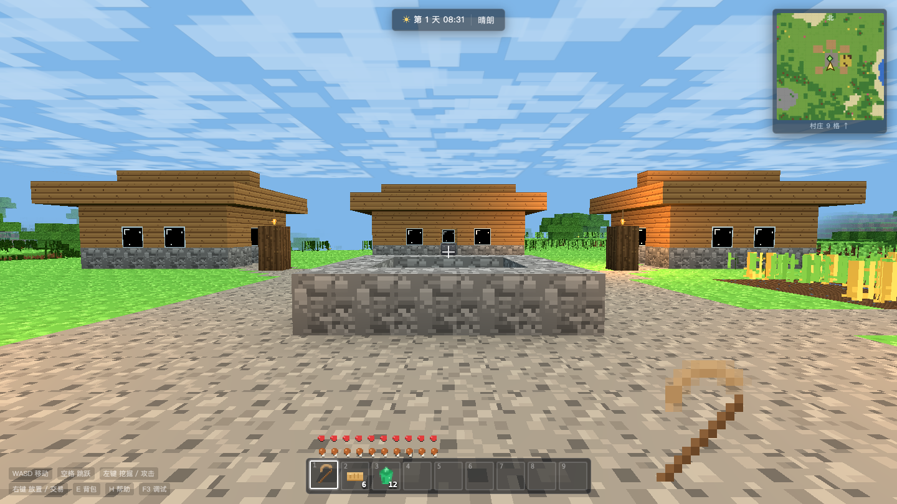
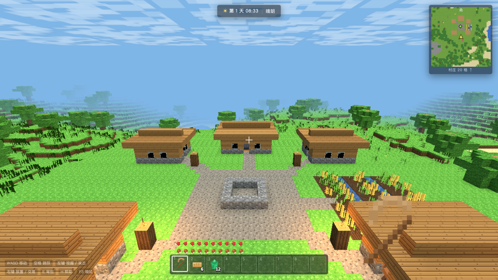
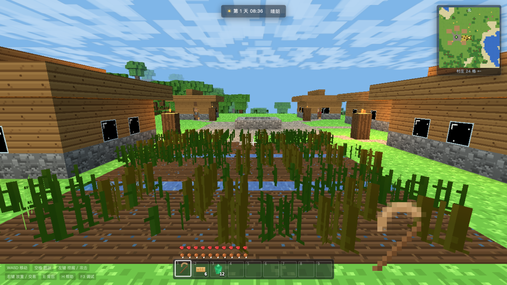
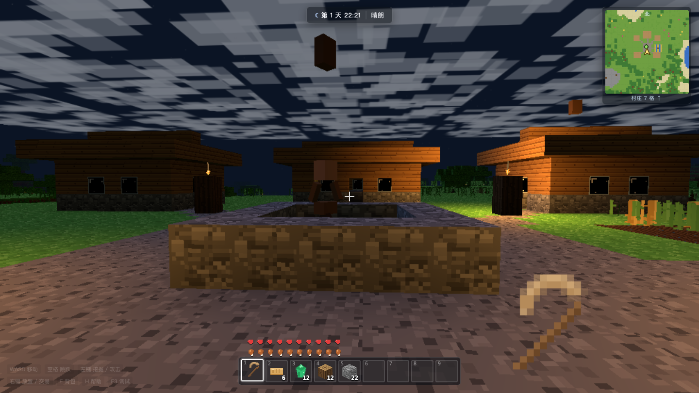
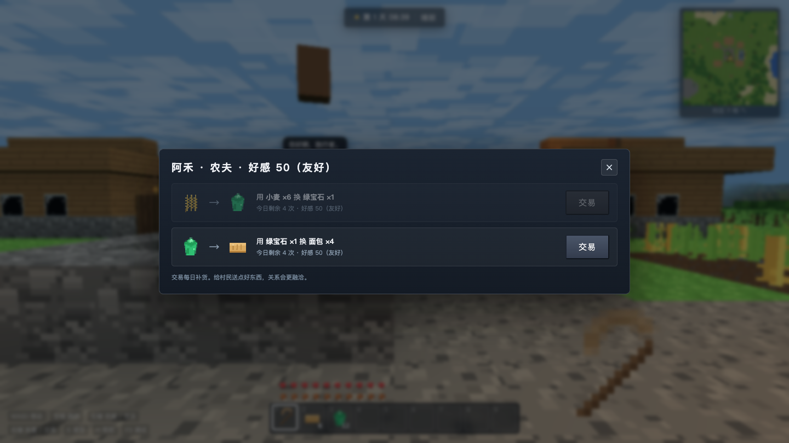

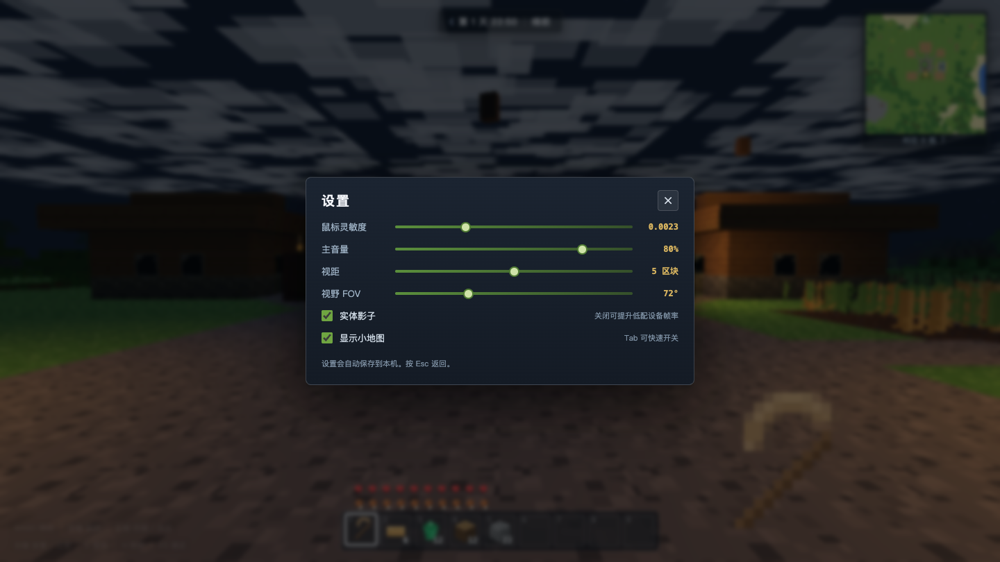
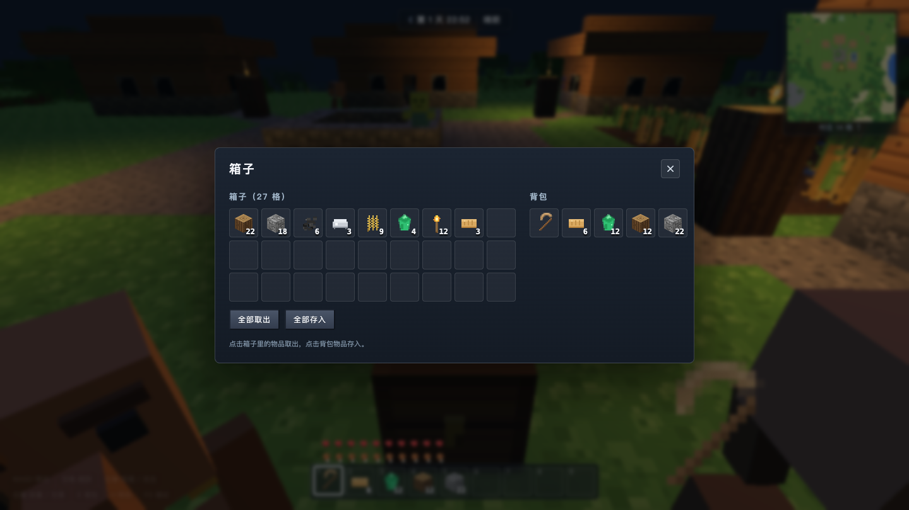
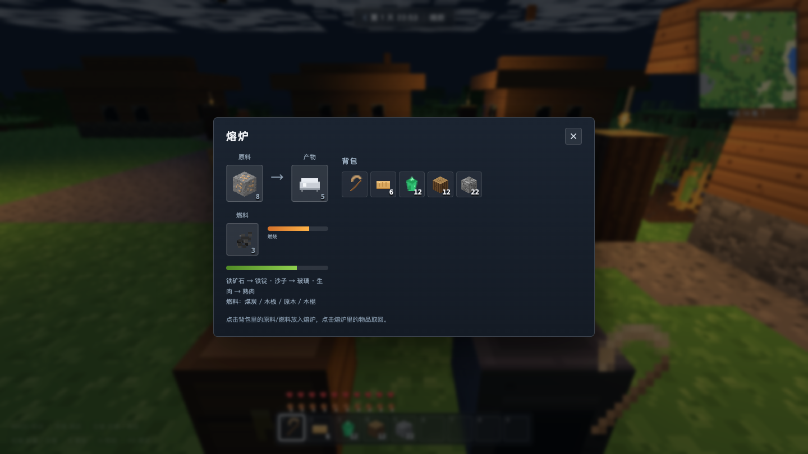
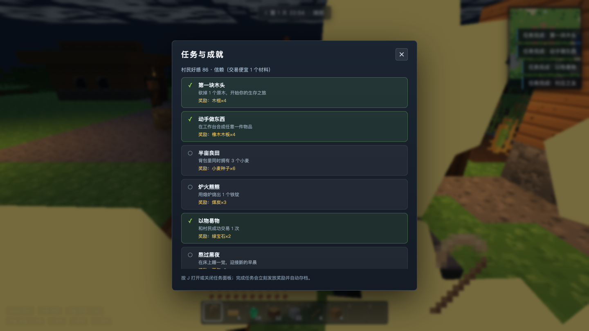
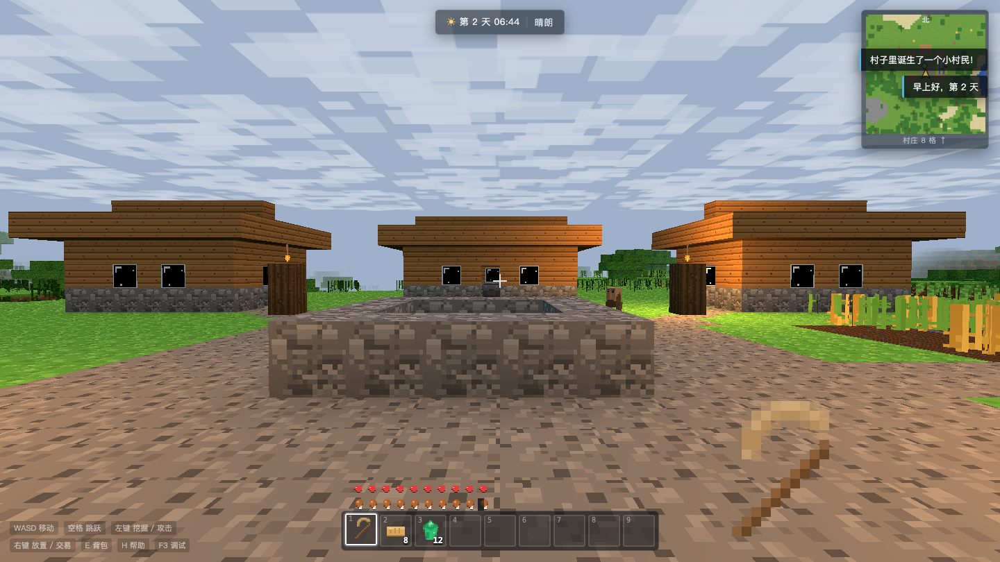
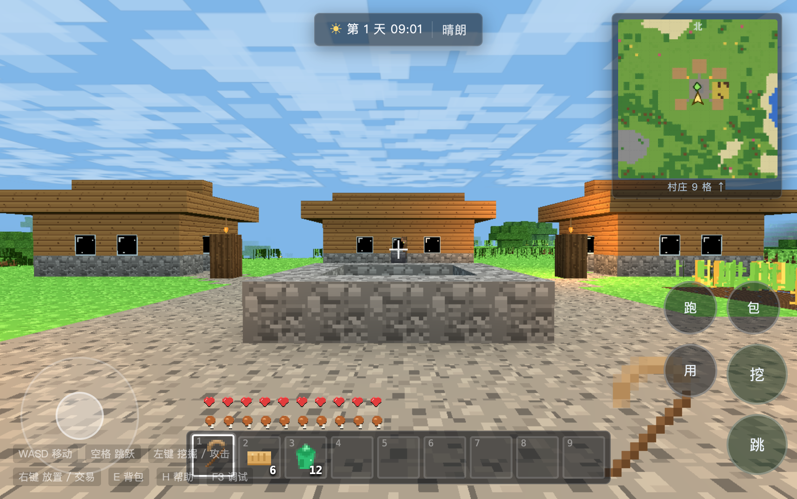
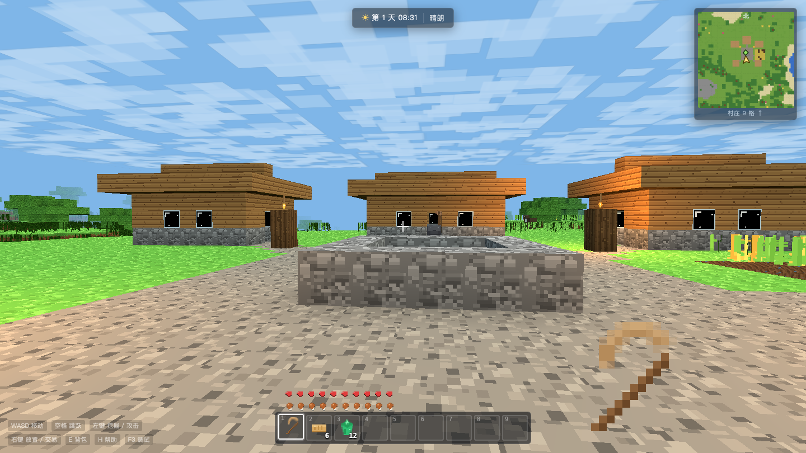

---

## 操作

| 操作 | 按键 |
|---|---|
| 移动 | W A S D |
| 跳跃 | 空格 |
| 奔跑 | 按住 Shift |
| 环顾 | 鼠标（点击画面锁定鼠标） |
| 挖掘 / 攻击 / 收割 | 按住左键 |
| 放置方块 / 吃东西 / 和村民交易 / 开箱子 / 开熔炉 | 右键 |
| 取方块到快捷栏（创造式） | 鼠标中键 |
| 切换快捷栏 | 1–9 或鼠标滚轮 |
| 背包与合成 | E |
| 小地图开关 | Tab |
| 任务与成就 | J |
| 帮助 | H |
| 调试信息 | F3 |
| 静音 / 取消静音 | M |
| 暂停 / 退出鼠标锁定 | Esc |

- 准星对准村民按右键可以**打开交易**（需靠近到 4 格内）。
- 背包界面里点物品可以把它放到当前快捷栏格子；中键可以把准星指着的方块「取」到快捷栏。
- 夜晚对准床按右键可以**睡到清晨**（附近有僵尸时无法入睡）。
- 死亡后会回到村庄重生，背包清空，但世界和村民会保留。
- **触屏设备**：自动显示左侧摇杆、右侧拖动视角区，以及右下角 跳/挖/用/包/跑 按钮。

---

## 世界与自然规则

- **昼夜循环**：一整天约 12 分钟。太阳、月亮、星空、云层都会随时间移动，清晨和黄昏天空会变成暖色。
- **天气**：晴天、下雨、雷雨会随机切换。下雨时天空变暗、雨丝落下，作物长得更快，**露天的火会被雨浇灭**；雷雨会打闪电，劈中地面可能**引燃火焰**。
- **火焰**：会顺着木头、树叶、草丛蔓延，遇到水或雨水会被浇灭，烧一段时间后自己熄灭；村民看到火会跑来帮忙灭火。
- **水流**：挖开靠水的方块，水会顺着缺口往下流、向低处漫延；下雨时耕地会保持湿润。
- **作物**：小麦分 4 个生长阶段，种在耕地上、旁边有水、有光照（白天或火把附近）才会长；成熟后可以收割，重新种下种子。
- **草地蔓延**：白天裸露的泥土会慢慢长出草；草方块被方块压住会退化回泥土；草丛也会自己向旁边蔓延。
- **树苗成树**：把树苗种在草地/泥土上，等一会儿它会自己长成一棵橡树。
- **动物**：绵羊、牛、猪、鸡会在草地上自然生成，会闲逛、会自己跳上矮台阶；羊会吃草，把草方块啃成泥土；拿着小麦/种子靠近它们会被吸引。
- **僵尸**：夜晚在离村庄较远的地方生成，会绕路追着玩家攻击；白天会被阳光点燃，烧成灰。
- **饥饿与生命**：奔跑、跳跃、挖矿会消耗饥饿；吃饱且饥饿值足够时会缓慢回血；饿到 0 会掉血。
- **水下**：可以潜水，有氧气条，氧气耗尽会溺水；水下画面会变蓝、声音会变闷。

---

## NPC 村民

村庄里有 5 位村民（农夫、图书管理员、铁匠、屠夫），他们会按自己的作息生活：

- **8:00–17:00 工作**：农夫去田里照看小麦（会收割成熟的小麦并补种）；铁匠在铁砧旁敲打；图书管理员守着书架；屠夫在广场摆摊。
- **17:00–19:00 闲聊**：走到广场，和其他村民聊天。
- **19:00–次日 6:00 回家睡觉**，夜里靠近能听到「Zzz…」。
- 白天靠近村民，他们会主动和你打招呼；夜里村民会提醒你回家。
- 被攻击会生气、逃跑，周围村民也会跟着跑；生气期间拒绝交易。
- 村民寻路使用共享的 **A\* 寻路**：会绕开墙、跳上 1 格台阶、从缺口穿过，而不是傻傻顶着墙走。
- 村庄有 7 张床，空床足够时，第二天早上会有**小村民出生**；小村民过几天会长大并选择一个职业。
- 和村民交易可以赚绿宝石，也会提升好感度。
- **好感度**会影响价格：好感 ≥70 便宜 1 个材料，≥90 便宜 2 个并额外多给 1 个产物；好感 <20 会被抬价。按 `J` 查看好感与任务。

### 交易表

| 村民 | 交易 |
|---|---|
| 农夫 阿禾 / 小满 | 小麦 ×6 → 绿宝石 ×1；绿宝石 ×1 → 面包 ×4 |
| 图书管理员 文竹 | 绿宝石 ×1 → 玻璃 ×8；绿宝石 ×2 → 书架 ×1 |
| 铁匠 铁柱 | 绿宝石 ×2 → 铁镐 ×1；煤炭 ×6 → 绿宝石 ×1 |
| 屠夫 大壮 | 绿宝石 ×1 → 生肉 ×3；羊毛 ×2 → 绿宝石 ×1 |

交易次数每天刷新（每天最多 3–4 次）。

---

## 生产与建造

- **锄头**：木锄 / 石锄 / 铁锄，右键草地或泥土开垦成耕地；上方要留空。
- **小麦**：耕地旁有水会长得更快；成熟后收割得到小麦和种子，可以再种。
- **箱子**：27 格储物，右键打开；里面的东西跟随存档保存；拆掉箱子会把物品放回背包。
- **熔炉**：右键打开，左边放原料、下面放燃料、右边取产物，有燃烧条和熔炼进度条。
  - 铁矿石 ×1 → 铁锭 ×1（8 秒）
  - 沙子 ×1 → 玻璃 ×1（6 秒）
  - 生肉 ×1 → 熟肉 ×1（6 秒，回复 8 点饥饿）
  - 燃料：煤炭 20 秒 / 原木 12 秒 / 木板 8 秒 / 木棍 4 秒
- **动物繁殖**：给绵羊/牛/猪喂小麦、给鸡喂小麦种子，两只同类靠近会生下宝宝；
  小动物约 2 天后长大；每种动物有数量上限，生过宝宝后需要休息一段时间。

---

## 合成表

开局自带木镐、6 个面包、12 颗绿宝石（可以先去和村民换东西）。

| 产物 | 所需材料 |
|---|---|
| 橡木木板 ×4 | 原木 ×1 |
| 木棍 ×4 | 木板 ×2 |
| 工作台 | 木板 ×4 |
| 火把 ×4 | 煤炭 ×1 + 木棍 ×1 |
| 木镐 / 木斧 / 木剑 | 木板 + 木棍 |
| 石镐 / 石斧 / 石剑 | 圆石 + 木棍 |
| 铁镐 / 铁斧 / 铁剑 | 铁锭 + 木棍 |
| 木锄 / 石锄 / 铁锄 | 木板或圆石或铁锭 + 木棍 |
| 箱子 | 木板 ×8 |
| 熔炉 | 圆石 ×8 |
| 面包 | 小麦 ×3 |
| 床 | 羊毛 ×3 + 木板 ×3 |
| 书架 | 木板 ×6 |

铁锭、玻璃不再直接合成，改用**熔炉**烧制。矿石分布：煤炭和铁矿在山体内部，钻石在很深的地下；用对应的镐子挖更快。

---

## 任务与成就

按 `J` 打开任务面板，一共 8 个任务，全部自动检测进度：

1. 第一块木头：砍 1 个原木
2. 动手做东西：合成任意物品
3. 半亩良田：背包里有 3 个小麦
4. 炉火熊熊：烧出 1 个铁锭
5. 以物易物：成功交易 1 次
6. 熬过黑夜：在床上睡一觉
7. 夜行者：击倒 1 只僵尸
8. 村庄之友：村民好感达到 70

完成任务会立刻发放物品/好感奖励、播放音效并自动存档。任务面板同时显示当前好感等级和交易折扣。

---

## 界面与设置

- **小地图**：右上角实时显示周围地形、玩家朝向和村庄方位（`Tab` 开关，设置里也能关）。
- **设置**（暂停菜单 → 设置）：鼠标灵敏度、主音量、视距、视野 FOV、阴影开关、小地图开关，全部自动保存。
- **HUD**：生命、饥饿、快捷栏、时钟与天气、手持物品名称、气泡对话。
- **环境音**：白天鸟鸣与风声、夜晚虫鸣与猫头鹰、雨天雨声、地下洞穴滴水与低频嗡鸣；
  脚步声按草地/石头/沙地/木头/泥土/砂砾/水面区分；村民和僵尸的声音有方位感（左右声像 + 距离衰减）。
- **动态分辨率**：帧率偏低时自动降低渲染分辨率，流畅后再升回来。

---

## 存档、导出与分享

- 3 个存档位（开始界面选择），键名分别是 `mc_sandbox_save_v1`（存档 1）、`mc_sandbox_save_v1_slot2`、`mc_sandbox_save_v1_slot3`。
- 世界每 2 分钟自动保存一次，暂停菜单里也可以手动「保存世界」。
- **导出存档**：暂停菜单 → 导出存档，会下载一个 `方块世界-第N天-存档.json`。
- **导入存档**：暂停菜单 → 导入存档，选择之前导出的 JSON 即可接着玩。
- 存档保存在浏览器的 `localStorage`，只存在本机这个浏览器里；换浏览器/清理数据/无痕模式会读不到。
- 世界只保存你改过的方块（以及玩家状态、时间、箱子、熔炉、村民、任务、好感），所以存档很小。

---

## 文件结构

```
mc-sandbox/
├── index.html            界面骨架（开始界面、HUD、背包、交易、箱子、熔炉、任务、设置、帮助、触屏）
├── style.css             像素风 UI 样式
├── vendor/three.min.js   Three.js r152（UMD，本地引入）
├── dist/index.html       单文件版（内联 CSS/JS/Three.js，可直接分享）
├── js/
│   ├── textures.js       程序化像素贴图图集 + 物品图标 + 天空贴图
│   ├── blocks.js         方块 / 物品 / 配方 / 熔炼 / 燃料数据
│   ├── audio.js          WebAudio 程序化音效、环境音、方位声像（无音频文件）
│   ├── world.js          地形生成、区块网格、光照 AO、村庄生成、射线检测、存档
│   ├── pathfinder.js     共享 A* 寻路（村民、僵尸）
│   ├── entities.js       生物模型、物理、动物 AI（繁殖/引诱）、僵尸 AI、实体管理
│   ├── villagers.js      村民作息 / 工作 / 交易 / 繁衍 / 逃跑 / 灭火 / 寻路
│   ├── nature.js         昼夜、天气、雨、闪电、火、水流、作物、动物刷新
│   ├── player.js         玩家移动、碰撞、挖掘、放置、使用（床/箱子/熔炉/锄头）、背包
│   ├── ui.js             HUD、快捷栏、小地图、背包合成、交易、箱子、熔炉、任务面板、气泡
│   ├── quests.js         成就 / 任务链
│   ├── game.js           渲染循环、输入、特效、手持物品、存档、导出导入、设置、界面联动
│   └── touch.js          触屏虚拟摇杆 / 视角拖动 / 动作按钮
├── screenshots/          游戏截图
├── tests/                Puppeteer 自动化测试与截图脚本（开发用，玩游戏不需要）
│   └── helpers/          测试公共启动器（浏览器路径解析）
├── package.json          npm 脚本与开发依赖（puppeteer-core）
├── LICENSE               MIT 许可证
└── THIRD_PARTY_NOTICES.md 第三方组件声明（Three.js）
```

---

## 开发笔记

- 全部使用经典 `<script>`（没有 ES Module），因此可以直接 `file://` 打开，不会遇到 CORS。
- 区块 16×16×64，默认视距 5 个区块；网格按不透明 / 十字植物 / 发光 / 水四种材质拆分，带顶点 AO。
- 世界是确定性噪声生成的，玩家改动以「方块差异表」保存并在区块重新生成时回放。
- 区块生成/建网格按帧预算时间切片（每帧最多生成 3 个区块、构建 2 组网格），避免卡顿。
- 想改世界参数：`js/world.js` 顶部（海平面、高度、视距）和 `baseHeight()`；想改一天时长：`js/nature.js` 的 `DAY_LENGTH`。
- 环境准备：Node.js ≥ 18 + 本机 Chrome/Chromium。
  ```bash
  npm install        # 安装 puppeteer-core
  ```
- 重新生成单文件版：
  ```bash
  npm run build      # 输出 dist/index.html
  ```
- 自动化测试（需要本机 Chrome；可用环境变量 `PUPPETEER_EXECUTABLE_PATH` 指定浏览器路径）：
  ```bash
  npm test           # 或单独运行 node tests/pack4.mjs
  npm run shots      # 重新生成 screenshots/
  ```
  测试文件位于 `tests/`，公共启动逻辑在 `tests/helpers/browser.mjs`。

---

## 非官方声明

本项目是个人独立开发的像素方块沙盒，**不是** Mojang Studios / Microsoft 的官方产品，也未获得其授权或认可。
项目中没有使用任何《Minecraft》的官方贴图、模型、音效或代码；所有美术与音频均由本项目代码在运行时程序化生成。
如果相关权利方认为有不妥之处，请通过 Issue 联系，我会及时调整。

## 许可证

本项目以 [MIT License](LICENSE) 开源，你可以自由使用、修改和分发。
内置的 Three.js 遵循其自身的 MIT 许可证，详见 [THIRD_PARTY_NOTICES.md](THIRD_PARTY_NOTICES.md)。

---

## 小提示

- 第一天先砍树 → 做工作台 → 做木镐 → 挖石头 → 做石镐，晚上点几个火把，僵尸就不会摸黑靠近。
- 想快速致富：种小麦，成熟后拿去和农夫换绿宝石；好感高了价格还会更便宜。
- 下雨天是种田的好时候，作物长得快，但露天挖的火堆会被浇灭。
- 雷雨天别站在树底下；看到村民往一个方向跑，可能是有房子着火了。
- 挖到铁矿石别急着扔，搭个熔炉烧成铁锭再做铁镐，效率高很多。